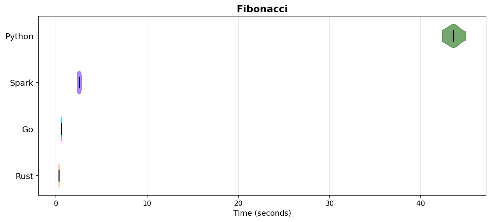
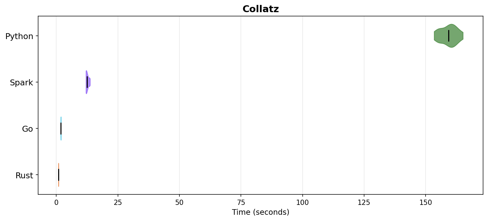
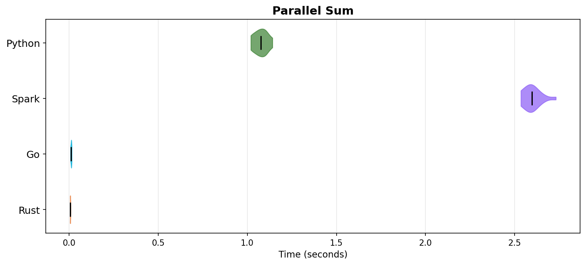
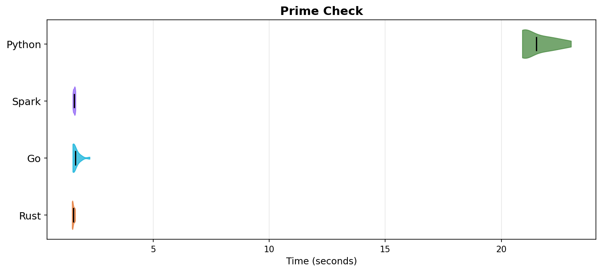
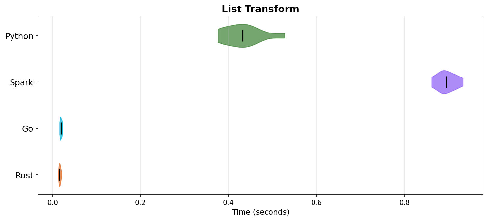

# Spark Benchmark Report — Initial Benchmarks

## Summary

| Benchmark      | Rust   | Go     | Spark   | Python   | Spark vs Rust |
| -------------- | ------ | ------ | ------- | -------- | ------------- |
| fibonacci      | 317ms  | 575ms  | 2.514s  | 43.568s  | 7.94x         |
| collatz        | 894ms  | 1.868s | 12.551s | 159.329s | 14.04x        |
| parallel-sum   | 7ms    | 12ms   | 2.596s  | 1.076s   | 365.91x       |
| prime-check    | 1.558s | 1.651s | 1.603s  | 21.502s  | 1.03x         |
| list-transform | 17ms   | 19ms   | 895ms   | 432ms    | 53.21x        |

## fibonacci

| Language | Mean    | Std Dev | Min     | Max     | vs Rust |
| -------- | ------- | ------- | ------- | ------- | ------- |
| Rust     | 317ms   | ±13ms   | 304ms   | 338ms   | 1.00x   |
| Go       | 575ms   | ±10ms   | 557ms   | 594ms   | 1.82x   |
| Spark    | 2.514s  | ±163ms  | 2.299s  | 2.774s  | 7.94x   |
| Python   | 43.568s | ±758ms  | 42.357s | 44.939s | 137.64x |

## collatz

| Language | Mean     | Std Dev | Min      | Max      | vs Rust |
| -------- | -------- | ------- | -------- | -------- | ------- |
| Rust     | 894ms    | ±26ms   | 869ms    | 968ms    | 1.00x   |
| Go       | 1.868s   | ±18ms   | 1.832s   | 1.893s   | 2.09x   |
| Spark    | 12.551s  | ±562ms  | 12.031s  | 13.728s  | 14.04x  |
| Python   | 159.329s | ±3.157s | 153.443s | 165.142s | 178.22x |

## parallel-sum

| Language | Mean   | Std Dev | Min    | Max    | vs Rust |
| -------- | ------ | ------- | ------ | ------ | ------- |
| Rust     | 7ms    | ±699us  | 6ms    | 9ms    | 1.00x   |
| Go       | 12ms   | ±2ms    | 8ms    | 15ms   | 1.65x   |
| Spark    | 2.596s | ±47ms   | 2.535s | 2.731s | 365.91x |
| Python   | 1.076s | ±36ms   | 1.020s | 1.141s | 151.69x |

## prime-check

| Language | Mean    | Std Dev | Min     | Max     | vs Rust |
| -------- | ------- | ------- | ------- | ------- | ------- |
| Rust     | 1.558s  | ±48ms   | 1.507s  | 1.644s  | 1.00x   |
| Go       | 1.651s  | ±181ms  | 1.535s  | 2.266s  | 1.06x   |
| Spark    | 1.603s  | ±38ms   | 1.536s  | 1.659s  | 1.03x   |
| Python   | 21.502s | ±675ms  | 20.903s | 23.003s | 13.81x  |

## list-transform

| Language | Mean  | Std Dev | Min   | Max   | vs Rust |
| -------- | ----- | ------- | ----- | ----- | ------- |
| Rust     | 17ms  | ±2ms    | 13ms  | 21ms  | 1.00x   |
| Go       | 19ms  | ±2ms    | 16ms  | 23ms  | 1.15x   |
| Spark    | 895ms | ±20ms   | 862ms | 933ms | 53.21x  |
| Python   | 432ms | ±43ms   | 376ms | 528ms | 25.69x  |
