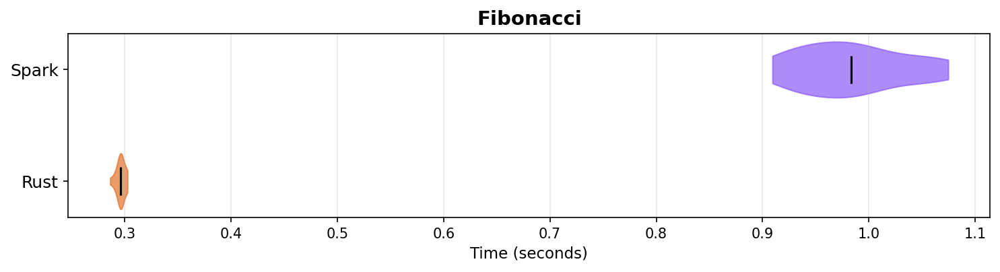
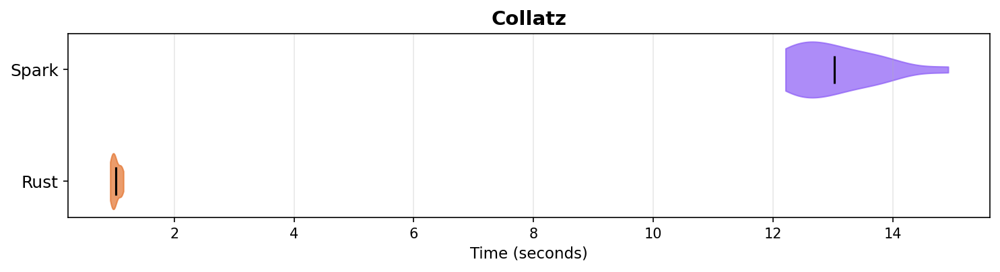
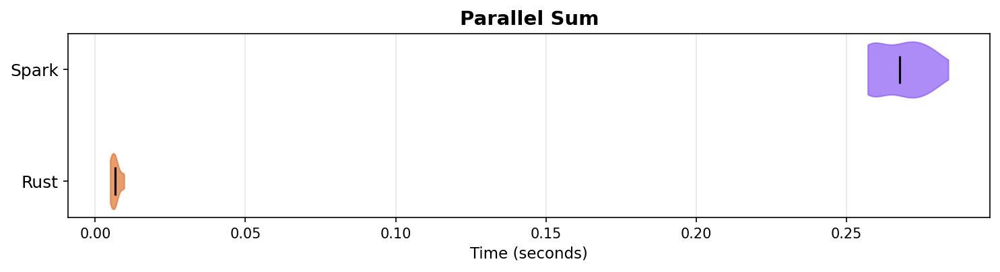
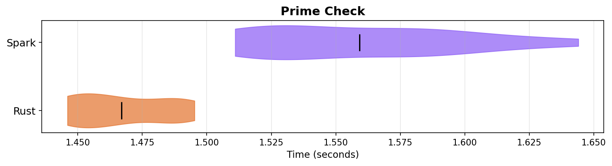
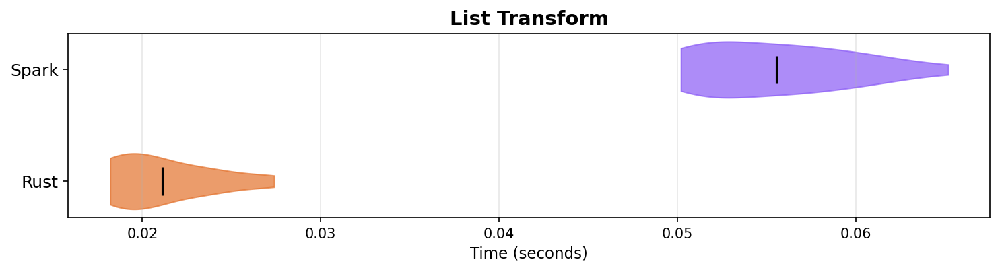

# Spark Benchmark Report — Function Calling Optimizations

## Summary

| Benchmark | Rust | Spark | Spark vs Rust |
|---|---|---|---|
| fibonacci | 296ms | 984ms | 3.32x |
| collatz | 1.021s | 13.020s | 12.75x |
| parallel-sum | 7ms | 268ms | 40.68x |
| prime-check | 1.467s | 1.559s | 1.06x |
| list-transform | 21ms | 56ms | 2.63x |

## fibonacci

| Language | Mean | Std Dev | Min | Max | vs Rust |
|----------|------|---------|-----|-----|---------|
| Rust | 296ms | ±4ms | 286ms | 303ms | 1.00x |
| Spark | 984ms | ±47ms | 909ms | 1.075s | 3.32x |

## collatz

| Language | Mean | Std Dev | Min | Max | vs Rust |
|----------|------|---------|-----|-----|---------|
| Rust | 1.021s | ±68ms | 932ms | 1.152s | 1.00x |
| Spark | 13.020s | ±701ms | 12.209s | 14.925s | 12.75x |

## parallel-sum

| Language | Mean | Std Dev | Min | Max | vs Rust |
|----------|------|---------|-----|-----|---------|
| Rust | 7ms | ±1ms | 5ms | 10ms | 1.00x |
| Spark | 268ms | ±8ms | 257ms | 284ms | 40.68x |

## prime-check

| Language | Mean | Std Dev | Min | Max | vs Rust |
|----------|------|---------|-----|-----|---------|
| Rust | 1.467s | ±18ms | 1.446s | 1.495s | 1.00x |
| Spark | 1.559s | ±38ms | 1.511s | 1.644s | 1.06x |

## list-transform

| Language | Mean | Std Dev | Min | Max | vs Rust |
|----------|------|---------|-----|-----|---------|
| Rust | 21ms | ±3ms | 18ms | 27ms | 1.00x |
| Spark | 56ms | ±4ms | 50ms | 65ms | 2.63x |

