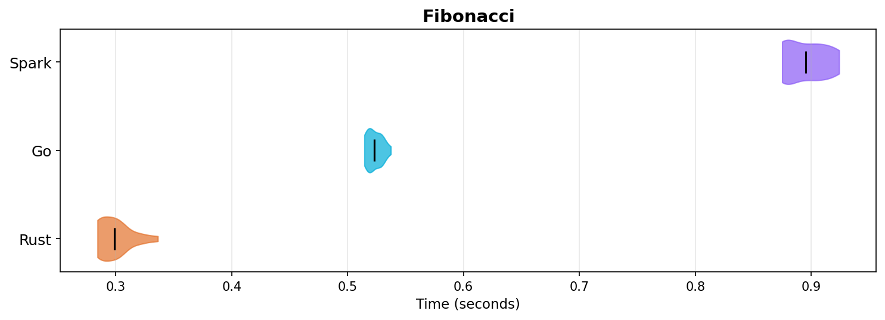
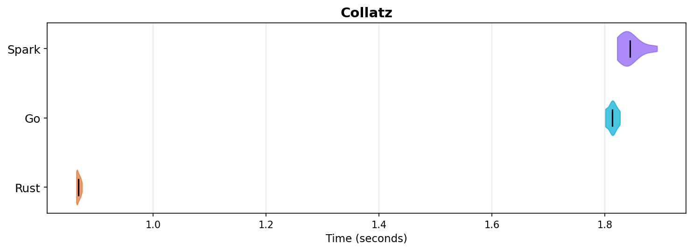
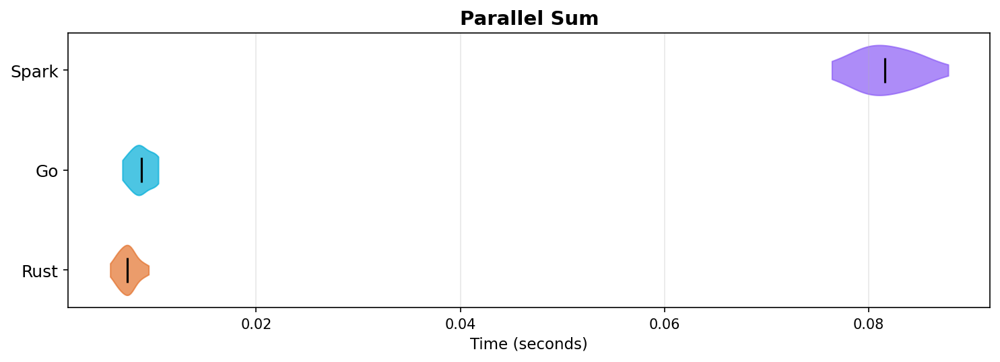
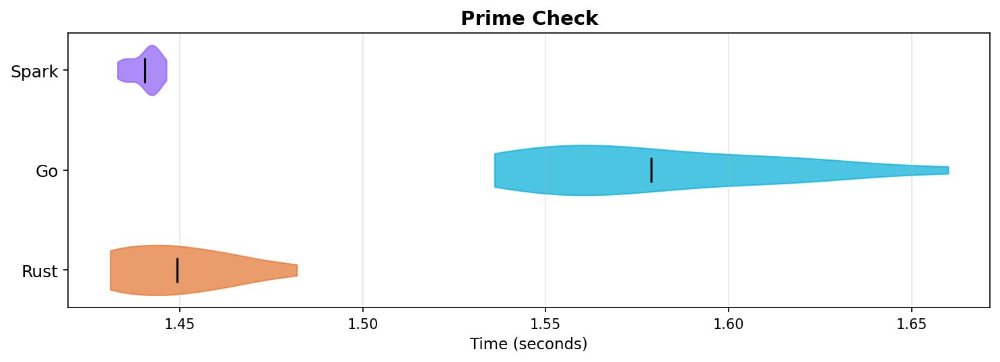
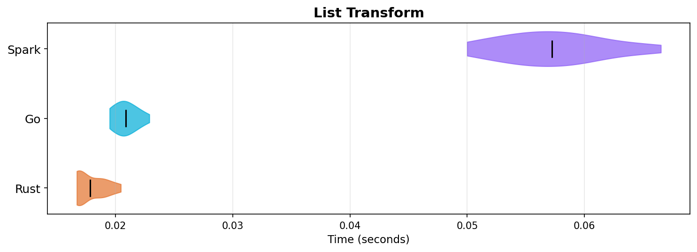

# Spark Benchmark Report — Optimization Passes

## Summary

| Benchmark | Rust | Go | Spark | Spark vs Rust |
|---|---|---|---|---|
| fibonacci | 299ms | 523ms | 895ms | 3.00x |
| collatz | 868ms | 1.813s | 1.845s | 2.13x |
| parallel-sum | 7ms | 9ms | 82ms | 11.03x |
| prime-check | 1.449s | 1.579s | 1.440s | 0.99x |
| list-transform | 18ms | 21ms | 57ms | 3.21x |

## fibonacci

| Language | Mean | Std Dev | Min | Max | vs Rust |
|----------|------|---------|-----|-----|---------|
| Rust | 299ms | ±14ms | 284ms | 336ms | 1.00x |
| Go | 523ms | ±6ms | 514ms | 537ms | 1.75x |
| Spark | 895ms | ±17ms | 875ms | 924ms | 3.00x |

## collatz

| Language | Mean | Std Dev | Min | Max | vs Rust |
|----------|------|---------|-----|-----|---------|
| Rust | 868ms | ±3ms | 864ms | 874ms | 1.00x |
| Go | 1.813s | ±8ms | 1.801s | 1.827s | 2.09x |
| Spark | 1.845s | ±19ms | 1.822s | 1.893s | 2.13x |

## parallel-sum

| Language | Mean | Std Dev | Min | Max | vs Rust |
|----------|------|---------|-----|-----|---------|
| Rust | 7ms | ±906us | 6ms | 9ms | 1.00x |
| Go | 9ms | ±1ms | 7ms | 10ms | 1.18x |
| Spark | 82ms | ±3ms | 76ms | 88ms | 11.03x |

## prime-check

| Language | Mean | Std Dev | Min | Max | vs Rust |
|----------|------|---------|-----|-----|---------|
| Rust | 1.449s | ±15ms | 1.431s | 1.482s | 1.00x |
| Go | 1.579s | ±33ms | 1.536s | 1.660s | 1.09x |
| Spark | 1.440s | ±4ms | 1.433s | 1.446s | 0.99x |

## list-transform

| Language | Mean | Std Dev | Min | Max | vs Rust |
|----------|------|---------|-----|-----|---------|
| Rust | 18ms | ±1ms | 17ms | 20ms | 1.00x |
| Go | 21ms | ±950us | 20ms | 23ms | 1.17x |
| Spark | 57ms | ±4ms | 50ms | 67ms | 3.21x |

