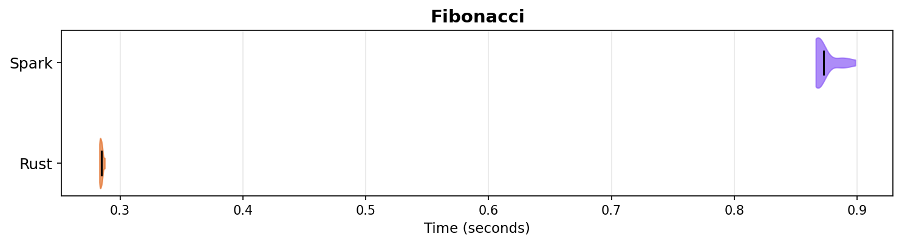
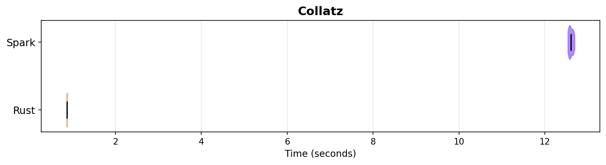
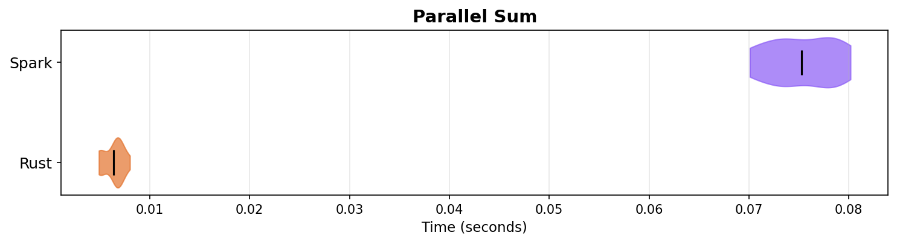
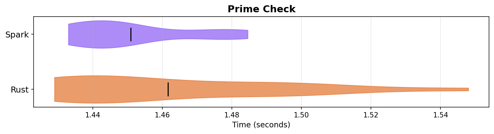
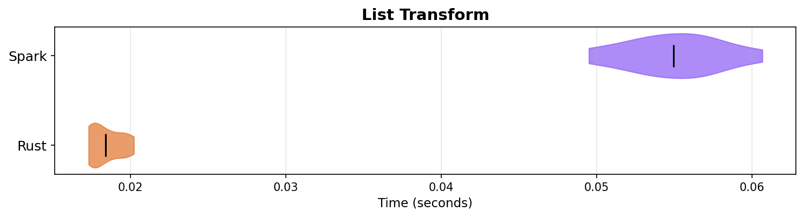

# Spark Benchmark Report — Pipeline Overhaul

Historical measurements for the dated run. See the [benchmark lab](../../README.md) for current reproduction commands.

## Summary

| Benchmark | Rust | Spark | Spark vs Rust |
|---|---|---|---|
| fibonacci | 285ms | 873ms | 3.07x |
| collatz | 867ms | 12.607s | 14.55x |
| parallel-sum | 6ms | 75ms | 11.81x |
| prime-check | 1.462s | 1.451s | 0.99x |
| list-transform | 18ms | 55ms | 2.98x |

## fibonacci

| Language | Mean | Std Dev | Min | Max | vs Rust |
|----------|------|---------|-----|-----|---------|
| Rust | 285ms | ±1ms | 283ms | 288ms | 1.00x |
| Spark | 873ms | ±9ms | 866ms | 899ms | 3.07x |

## collatz

| Language | Mean | Std Dev | Min | Max | vs Rust |
|----------|------|---------|-----|-----|---------|
| Rust | 867ms | ±1ms | 865ms | 869ms | 1.00x |
| Spark | 12.607s | ±48ms | 12.536s | 12.695s | 14.55x |

## parallel-sum

| Language | Mean | Std Dev | Min | Max | vs Rust |
|----------|------|---------|-----|-----|---------|
| Rust | 6ms | ±941us | 5ms | 8ms | 1.00x |
| Spark | 75ms | ±3ms | 70ms | 80ms | 11.81x |

## prime-check

| Language | Mean | Std Dev | Min | Max | vs Rust |
|----------|------|---------|-----|-----|---------|
| Rust | 1.462s | ±32ms | 1.429s | 1.548s | 1.00x |
| Spark | 1.451s | ±17ms | 1.433s | 1.485s | 0.99x |

## list-transform

| Language | Mean | Std Dev | Min | Max | vs Rust |
|----------|------|---------|-----|-----|---------|
| Rust | 18ms | ±974us | 17ms | 20ms | 1.00x |
| Spark | 55ms | ±3ms | 50ms | 61ms | 2.98x |

